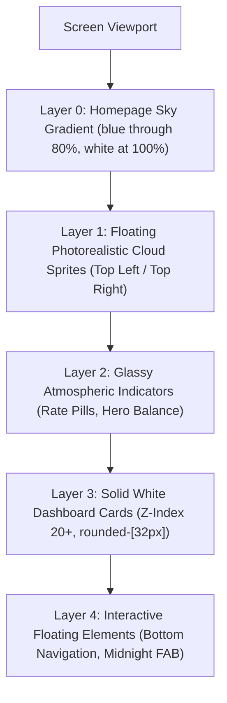

# SuperFlex Modern Design System Specification ("Sky & Midnight")

> **Version**: 1.1.0
> **Aesthetic Philosophy**: Atmospheric minimalism: a sky gradient, solid white account cards, deep plum actions, and lilac accents. The login uses its compact gradient; the homepage keeps blue through roughly 80% of the viewport before fading to white.

---

## 1. Overview & Core Philosophy

The **"Sky & Midnight"** design language is an ultra-clean, high-contrast, modern UI system inspired by next-generation financial and mobile applications. It replaces outdated dark skeuomorphism and heavy blurred drop-shadows with:

1. **Atmospheric Sky Backdrops**: Silky, vibrant sky-blue vertical gradients complemented by gentle, photorealistic cumulus clouds.
2. **Solid Geometric Surfaces**: Homepage dashboard cards use solid white in light mode and solid black with a fine border in dark mode. Keep a consistent `32px` radius and no shadows. The login form stays flat with its own `32px` card radius.
3. **The "Midnight & Lilac" Action Hierarchy**:
   - **Primary Action**: Deep Midnight Plum / Purple (`#1e0838`) with pure white icons and text.
   - **Secondary Action**: Soft Pastel Lilac / Lavender (`#dfc8fc` / `#e9ddff`) with midnight purple text (`#1e0838`).
   - **Translucent Accent**: Glassy sky-blue secondary pills (`rgba(255, 255, 255, 0.35)`) for badges, rates, and navigation tracks.
4. **Pill & Squircle Geometry**: Strict adherence to pill-shaped interactive elements (`rounded-full`) and squircle media/logo containers (`rounded-2xl` / `rounded-3xl`).

---

## 2. Color Palette & Design Tokens

### 2.1 Background & Atmospheric Colors

| Token Name             | Hex / Value                 | Tailwind / CSS Equivalent      | Purpose                                         |
| :--------------------- | :-------------------------- | :----------------------------- | :---------------------------------------------- |
| `sky-gradient-start`   | `#62abe0`                   | `from-[#62abe0]`               | Bright blue at the top of the login sky band    |
| `sky-gradient-mid`     | `#9ac7e8`                   | `via-[#9ac7e8]`                | Soft blue through the center                    |
| `sky-gradient-end`     | `#e4eff7`                   | `to-[#e4eff7]`                 | Pale horizon fading into white                  |
| `sky-glass-pill`       | `rgba(255, 255, 255, 0.35)` | `bg-white/35 backdrop-blur-sm` | Translucent pills (e.g. Rate pill, version tag) |
| `sky-glass-pill-hover` | `rgba(255, 255, 255, 0.45)` | `hover:bg-white/45`            | Hover state for translucent sky pills           |

The login gradient ends at white/black at `57%`. The homepage uses its own longer gradient: retain rich sky blue through about `80%`, then fade into white from `80%` to `100%`. In dark mode, retain the blue night sky through `80%` and fade to black over the final `20%`.

### 2.2 Brand & Interactive Colors

| Token Name                | Hex / Value | Tailwind / CSS Equivalent         | Purpose                                                      |
| :------------------------ | :---------- | :-------------------------------- | :----------------------------------------------------------- |
| `primary-midnight`        | `#230052`   | `bg-[#230052]` / `text-[#230052]` | Login primary action and brand accents                       |
| `primary-midnight-hover`  | `#2a0c4f`   | `hover:bg-[#2a0c4f]`              | Hover state for primary buttons                              |
| `primary-midnight-active` | `#150428`   | `active:bg-[#150428]`             | Active/pressed state for primary buttons                     |
| `secondary-lilac`         | `#dfc8fc`   | `bg-[#dfc8fc]` / `text-[#1e0838]` | Secondary pill action buttons (e.g. "Share", "I understand") |
| `secondary-lilac-hover`   | `#d2afff`   | `hover:bg-[#d2afff]`              | Hover state for secondary lilac buttons                      |
| `badge-lavender`          | `#cfa7f5`   | `bg-[#cfa7f5]`                    | Lavender accent badges elsewhere in the app                  |
| `callout-lilac-bg`        | `#f2ecfc`   | `bg-[#f2ecfc]`                    | In-card callout banners and notice highlights                |

### 2.3 Surface & Neutral Colors

| Token Name        | Hex / Value             | Purpose                                                     |
| :---------------- | :---------------------- | :---------------------------------------------------------- |
| `surface-card`    | `#ffffff` (Solid)       | Flat main cards, sheets, dialog surfaces (zero drop-shadow) |
| `surface-input`   | `#f8f9fa` or `#ffffff`  | Input field background with `border-slate-200`              |
| `text-primary`    | `#080808`               | Login headline and main titles                              |
| `text-secondary`  | `#626262`               | Login body copy and secondary descriptions                  |
| `text-muted`      | `#94a3b8` (Slate 400)   | Placeholders, inactive tab labels, borders                  |
| `status-positive` | `#16a34a` (Emerald 600) | Positive growth percentages (`+2.05% ↗`)                    |
| `status-negative` | `#dc2626` (Red 600)     | Negative decline percentages (`-3.51% ↘`)                   |

---

## Login screen: onboarding reference

The second supplied screenshot guides the login palette, rounded controls, white surface, and restrained typography. Use SuperFlex branding and student portal language. Keep the university portal's real username, password, and password reset behavior; the sample email field is a visual reference for the control shape.

### Composition and spacing

1. **Sky fade:** Apply the gradient to the full page background: `#62abe0` at the top, blue through roughly the upper two-fifths, pale blue near the midpoint, and white by `57%` of the viewport. Keep the page containers transparent so the fade reaches the viewport edges. Do not insert an empty hero or spacer element; center the card with the wrapper's flex layout.
2. **Sign-in card:** Center a flat white card and the quiet footer as one vertical group against the page gradient. Use a `480px` maximum card width, `32px` corner radius, and responsive `14px`–`28px` vertical / `20px`–`32px` horizontal padding. Keep a small gap before the footer. The card has no border or shadow and must not rely on an empty hero element for placement.
3. **Form introduction:** Show the existing black squircle favicon with its purple lightning bolt at `52px`, with “Superflex” beside it in the same row. Place “Welcome back! Enter your FLEX details and let's get you signed in.” beneath the full row. Use about `30px` for the heading, weight `500`, line height near `1.03`; body copy is `15px` with `1.35` line height. Keep a `12px` gap between the icon and heading and about `10px` below the row.
4. **Controls:** White outlined pill fields `50px` tall with `22px` horizontal inset. Use a crisp plum focus outline. Keep `6px`–`8px` between field groups, then a `52px` plum pill submit button with a white right arrow. Center the existing Cloudflare Turnstile widget inside the card and set `data-theme="light"` before its implicit render. Labels and reset link stay visible and keyboard accessible. Hide the redundant roll number helper text when the label and placeholder already show the format.
5. **Footer and updates:** Show the original version button above the card in the current rate-capsule style: a translucent white outer pill, a solid white inner chip with the lavender check icon and installed version in plum, and white status text reading “SuperFlex Active.” When GitHub reports a newer release, change the status text to “New Update Available: v…” and link the pill to the release. Keep Privacy Policy and Star on GitHub links beneath the form in quiet gray text. Add an icon button in that row to switch between light and dark mode; label it for screen readers and save the choice as `superflex-theme-mode`. Keep the login light by default. In dark mode, fade from `#000C22` at the top to `#000000` near the lower half; use black cards with a subtle border and white field labels. Dark input pills use `#D9D9D9` at 8% opacity for their fill and a 6px inside stroke of `#F9F9F9` at 23% opacity. Do not show “Made for FLEX.”

### Sign-in and password reset alignment

Both states use the same `480px` card width, responsive padding, `32px` radius, and centered position. Both headers use a two-column row: sign-in shows the black and purple favicon beside “Superflex”; reset shows a `52px` circular navy back button with a white arrow beside “Forgot your password?”. Supporting text spans the full width below the row. The reset card uses the measured height of the sign-in card, including the Turnstile widget, so the card edges and footer do not jump. Measure the space below the Sign In button, including its reset link, and reserve the same space below Request Reset Link so both primary buttons occupy the same position. Keep the email field below the description. Give the back button a clear accessible name.

### UX writing

- Use **Superflex** as the sign-in heading and **FLEX** for the university system.
- Keep login copy conversational and focused on entering FLEX credentials. Avoid broad platform marketing claims.
- Keep actions direct: “Sign in”, “Forgot your password?”, and “Request Reset Link”. The reset explanation should refer to the email linked to the user's FLEX account.

## Account screens: match the login theme

The homepage, sidebar, and account pages use the same light and dark color rules as the login screen. Read the saved `superflex-theme-mode` value and apply the `.dark` class to the document root. All `dark:` styles must follow that class so the interface does not change when the operating system theme differs from the saved app theme.

| Surface              | Light mode                                             | Dark mode                                                                                |
| :------------------- | :----------------------------------------------------- | :--------------------------------------------------------------------------------------- |
| Page backdrop        | Blue sky gradient beginning at `#62ABE0`               | Dark blue-to-black night gradient                                                        |
| Main dashboard cards | Solid white, fine `rgba(0,0,0,0.06)` border, no shadow | Solid black, fine `rgba(255,255,255,0.14)` border, no shadow                             |
| Main text            | `#101010`                                              | `#f5f6fb`; supporting copy `#c4cad6`                                                     |
| Primary buttons      | `#230052` with white text; hover `#370c72`             | Accent lavender `#a098ff` with `#0a192f` text; hover `#b7b0ff`                           |
| Secondary buttons    | Lilac `#dfc8fc` with `#230052` text; hover `#d2afff`   | Accent lavender `#a098ff` with `#0a192f` text, or translucent white for neutral controls |
| Cloud artwork        | Visible over the sky gradient                          | `12%` opacity over the night gradient                                                    |

The homepage greeting is a transparent masthead over the sky backdrop; keep it separate from content cards. Use solid dashboard cards in both themes with `rounded-[32px]` corners. Keep the four overview stat cards in equal-width columns on wide screens and two columns on tablet screens. Align the Course Performance and Attendance Overview panels to equal heights with consistent padding and icon-led headers. Course Performance shows course tabs and expandable assessment categories. Attendance Overview shows a row for each subject with one square per class session; use the theme accent for present sessions, rose for absent sessions, and a neutral fill when status is unknown. Keep the login form card flat and separate from dashboard cards.

The login shell is `100dvh` tall with page scrolling disabled. Center the card and footer together while keeping the form, CAPTCHA, submit action, and footer visible. Reduce card padding and form spacing on short displays. Terms modal content may scroll inside its own dialog. Never hide CAPTCHA, validation, or password reset to force the fit. On desktop, keep the card centered at a maximum width of `480px`.

---

## 3. Atmospheric Background & Cloud Implementation

As seen in the primary checking screen, the background combines a rich vertical sky gradient with soft, photorealistic white clouds in the upper half of the viewport.



### 3.1 Cloud Layer Specifications

- **Positioning**: Fixed or absolute in the background (`pointer-events-none -z-10`).
- **Placement**:
  - **Top-Right Cloud**: Large cumulus cloud billowing from the top-right corner (`w-[280px]` to `w-[360px]`, `top-[-20px] right-[-20px]`).
  - **Mid-Left Cloud**: Discrete wispy cloud floating midway (`w-[160px]` to `w-[220px]`, `top-[120px] left-[5%]`).
- **Visual Style**: Soft, organic edges blending natively into the sky gradient (photorealistic WebP/PNG or SVG feather mask, opacity `0.85`–`0.95`).
- **Animation (Optional)**: Ultra-gentle horizontal drift (e.g. `120s linear infinite alternate`).

### 3.2 HTML / Tailwind Code Pattern

```html
<div
  class="fixed inset-0 w-full h-full -z-10 overflow-hidden pointer-events-none bg-gradient-to-b from-[#3b8fe6] via-[#7abdf0] to-[#ddedf9]"
>
  <!-- Top-Right Fluffy Cloud -->
  

  <!-- Mid-Left Floating Cloud -->
  
</div>
```

---

## 4. Typography & Layout Metrics

- **Primary Font Family**: `'Google Sans Flex'`, `'Plus Jakarta Sans'`, or `system-ui, -apple-system, sans-serif`.
- **Letter Spacing**: Tight on large headings (`tracking-tight`), slightly expanded on uppercase micro-badges (`tracking-wider`).

| Element                   | Size          | Weight            | Tracking / Leading                             | Example                                  |
| :------------------------ | :------------ | :---------------- | :--------------------------------------------- | :--------------------------------------- |
| **Hero Numeric Balance**  | `48px`–`56px` | `800` (Extrabold) | `tracking-tight leading-none text-white`       | `$3.13` or `$0`                          |
| **Card Hero Heading**     | `28px`–`32px` | `800` (Extrabold) | `tracking-tight leading-[1.18] text-slate-900` | `"Superflex"`                            |
| **Modal / Section Title** | `20px`–`24px` | `800` (Bold)      | `tracking-tight text-slate-900`                | `"All stocks"`, `"U.S. markets run..."`  |
| **Card Subtitle / Body**  | `13px`–`14px` | `400` / `500`     | `leading-relaxed text-slate-500`               | Feature descriptions                     |
| **Section Label / Tag**   | `11px`–`12px` | `700` (Bold)      | `tracking-wide uppercase text-slate-400`       | `"CHECKING ACCOUNT"`, `"BASE"`           |
| **Pill / Button Label**   | `13px`–`14px` | `700` (Bold)      | `tracking-normal`                              | `"Sign In"`, `"Copy details"`, `"Share"` |

---

## 5. Component Specifications & Button Combinations

### 5.1 Button Pairings & Hierarchies

The design system uses deliberate button combinations to balance user prominence:

```
┌────────────────────────────────────────────────────────┐
│  Primary: [ Sign In              → ]                   │  <- Midnight Purple (#1e0838) + White
├────────────────────────────────────────────────────────┤
│  Dual Action:                                          │
│  [ Copy details ]              [      Share      ]     │
│  (#1e0838 Pill)                (#dfc8fc Lilac Pill)    │
├────────────────────────────────────────────────────────┤
│  Modal / Bottom Sheet Action:                          │
│  [                   I understand                    ] │  <- Lilac Pill (#dfc8fc) + #1e0838 text
└────────────────────────────────────────────────────────┘
```

#### A. Primary Action Button (Midnight Pill)

- **Geometry**: `rounded-full`, height `52px`, padding `px-7 py-3.5`.
- **Colors**: Background `#1e0838`, text `#ffffff`.
- **Shadow**: `shadow-none` (strictly flat).
- **Icon**: Right arrow (`<svg> <path d="M5 12h14"/> <path d="m12 5 7 7-7 7"/> </svg>`) in crisp 2.5px stroke.
- **Tailwind**:
  ```css
  bg-[#1e0838] hover:bg-[#2a0c4f] active:scale-[0.98] text-white rounded-full font-bold text-sm h-[52px] px-7 flex items-center justify-center gap-2 border-none shadow-none transition-all
  ```

#### B. Secondary Action Button (Lilac Pill)

- **Geometry**: `rounded-full`, height `52px` or `48px`, padding `px-6 py-3`.
- **Colors**: Background `#dfc8fc` (or `#e9ddff`), text `#1e0838`.
- **Shadow**: `shadow-none`.
- **Tailwind**:
  ```css
  bg-[#dfc8fc] hover:bg-[#d2afff] active:scale-[0.98] text-[#1e0838] rounded-full font-bold text-sm h-[52px] px-6 flex items-center justify-center gap-2 border-none shadow-none transition-all
  ```

#### C. Floating Action Button (Midnight Circle FAB)

- **Geometry**: Perfect circle `w-14 h-14 rounded-full`.
- **Colors**: Background `#1e0838`, icon `#ffffff` (`+` plus or search magnifying glass).
- **Shadow**: `shadow-none`.
- **Tailwind**:
  ```css
  w-14 h-14 rounded-full bg-[#1e0838] text-white flex items-center justify-center shadow-none border-none cursor-pointer active:scale-95 transition-transform
  ```

#### D. Translucent Secondary Glassy Pill

- **Geometry**: `rounded-full`, height `36px`–`40px`, padding `px-4 py-1.5`.
- **Colors**: Background `rgba(255, 255, 255, 0.35)`, text `#0f172a` or `#ffffff`.
- **Use Case**: Rate pill (`USD 1 = PKR 275.12 Today`), version banner.

---

### 5.2 Cards & Surface Containers

- **Zero-Shadow Rule**: Every card uses `box-shadow: none` (`!shadow-none`).
- **Corner Radius**: `rounded-[28px]` or `rounded-[32px]`.
- **Background**: Solid `#ffffff`.
- **Internal Callout Container**:
  - Background: Soft lilac `#f2ecfc` or `#f3edff`.
  - Radius: `rounded-2xl`.
  - Icon & Text: Midnight plum `#1e0838` with muted body `#475569`.

#### Card Template

```jsx
<div className="bg-white rounded-[32px] p-6 sm:p-8 flex flex-col gap-4 text-slate-900 shadow-none border-none">
  <div className="flex items-center justify-between">
    <h3 className="text-base font-extrabold text-slate-900">Network</h3>
    <button className="text-slate-400 hover:text-slate-700">
      <CopyIcon className="w-5 h-5" />
    </button>
  </div>

  <p className="text-lg font-bold text-slate-800">Base</p>

  {/* In-Card Soft Lilac Callout Notice */}
  <div className="p-4 rounded-2xl bg-[#f2ecfc] flex items-start gap-3">
    <InfoIcon className="w-5 h-5 text-[#1e0838] shrink-0 mt-0.5" />
    <p className="text-xs font-medium text-slate-700 leading-relaxed">
      Only send supported tokens on this network. Any other coin or network may be lost.
    </p>
  </div>
</div>
```

---

### 5.3 Modals & Bottom Sheets

As seen in the "U.S. markets run 7:30 PM" modal:

- **Overlay**: Soft backdrop `bg-slate-900/40` without heavy blur halos.
- **Card Surface**: Solid `#ffffff`, `rounded-[32px]`, zero shadow.
- **Header Badge**: Squircle container (`w-16 h-16 rounded-2xl bg-[#e9ddff]`) displaying the hero graphic or SuperFlex lightning emblem in `#1e0838`.
- **Action**: Full-width lilac button (`bg-[#dfc8fc] text-[#1e0838]`).

```jsx
<div className="fixed inset-0 z-50 flex items-center justify-center p-4 bg-slate-900/40">
  <div className="bg-white rounded-[32px] p-7 sm:p-8 w-full max-w-sm flex flex-col items-center text-center shadow-none border-none">
    {/* Centered Squircle Badge */}
    <div className="w-16 h-16 rounded-2xl bg-[#e9ddff] flex items-center justify-center mb-6">
      
    </div>

    {/* Title */}
    <h2 className="text-xl sm:text-2xl font-black text-slate-900 tracking-tight leading-snug">
      U.S. markets run 7:30 PM – 2:00 AM GMT+5
    </h2>

    {/* Subtitle */}
    <p className="text-slate-500 text-xs sm:text-sm font-normal mt-2.5 mb-7">
      You can place an order once they’re open.
    </p>

    {/* Action Lilac Button */}
    <button className="w-full bg-[#dfc8fc] hover:bg-[#d2afff] text-[#1e0838] font-bold text-sm py-3.5 px-6 rounded-full shadow-none border-none cursor-pointer transition-all">
      I understand
    </button>
  </div>
</div>
```

---

### 5.4 Segmented Track & Pill Switchers

As seen in the **All / Stocks / ETFs / Commodities** and **BASE / SOLANA** selectors:

- **Track**: Pill-shaped container (`rounded-full p-1 bg-white/40` or `bg-slate-100`).
- **Active State**:
  - In Category Filter: Solid midnight pill (`bg-[#1e0838] text-white rounded-full px-5 py-2`).
  - In Network Selector: Solid white pill (`bg-white text-slate-900 rounded-full px-6 py-2 shadow-none`).
- **Inactive State**: Transparent or faint pill (`text-slate-600 hover:text-slate-900 px-5 py-2`).

---

### 5.5 Form Inputs & Inline Action Controls

As seen in the onboarding login control and account action pills:

- **Geometry**: Pill-shaped (`rounded-full h-[52px] px-6`).
- **Background**: Soft off-white (`#f8f9fa`) or crisp white (`#ffffff`).
- **Border**: Subtle 1px `border-slate-200`.
- **Focus**: Sharp midnight border `focus:border-[#1e0838]`, **strictly `ring-0`** (no blur glow rings).
- **Inline Action Alternative**: Input with integrated circular arrow button positioned inside the right edge.

---

## 6. Iconography & Badges

- **SuperFlex Lightning Favicon**:
  - Use `assets/favicon.svg` for the sign-in card mark, displayed at `52px` without a separate colored badge background.
  - Path: `M247.227 185.616L282.286 69L133 216L186.861 231.146L133 363L298 208.65L247.227 185.616Z`.
  - Black squircle background with a `#A098FF` lightning bolt.
- **Navigation & Status Icons**:
  - Lucide / Clean SVG line icons, `stroke-width="2"` or `2.5`.
  - Rounded stroke ends (`stroke-linecap="round" stroke-linejoin="round"`).

---

## 7. Responsive Breakpoint Rules

| Breakpoint                    | Card Max Width                              | Padding                                      | Border Radius                           |
| :---------------------------- | :------------------------------------------ | :------------------------------------------- | :-------------------------------------- |
| **Mobile (`< 640px`)**        | Login: viewport minus `64px`; cards: `92vw` | Login: `32px` gutters; cards: `p-6` to `p-7` | Login: no card; cards: `rounded-[28px]` |
| **Tablet (`640px`–`1024px`)** | `480px` (Login content) / `520px` (Modal)   | Login: centered column; cards: `p-8`         | Login: no card; cards: `rounded-[32px]` |
| **Desktop (`> 1024px`)**      | Responsive container                        | `p-10`                                       | `rounded-[36px]`                        |

---

## 8. Summary Checklist for SuperFlex Developers

When creating or redesigning components under this system, verify:

- [ ] **Zero Drop Shadows**: No `shadow-lg`, `shadow-md`, or custom box-shadows. Use contrast against the sky gradient for depth.
- [ ] **No Fuzzy Glow Halos**: No blur glows behind cards or inputs. Focus states use crisp border lines.
- [ ] **Sky Backdrop**: Login keeps its compact gradient; the homepage stays blue through roughly 80% of the viewport, then fades to white.
- [ ] **Midnight Plum Primary**: Primary CTAs use `#1e0838` with white text and right-facing arrow `->`.
- [ ] **Soft Lilac Secondary**: Secondary CTAs use `#dfc8fc` / `#e9ddff` with `#1e0838` text.
- [ ] **Pill & Squircle Geometry**: Interactive elements are pills (`rounded-full`); icon containers are squircles (`rounded-2xl`).
- [ ] **Solid Dashboard Cards**: Homepage cards use solid white in light mode and solid black in dark mode, fine borders, no shadows, and a `32px` radius. Keep the login form card flat.
- [ ] **Theme Parity**: Homepage and account pages use the login light/dark gradients, cards, text, and button colors; `dark:` styles follow the saved app theme class.
